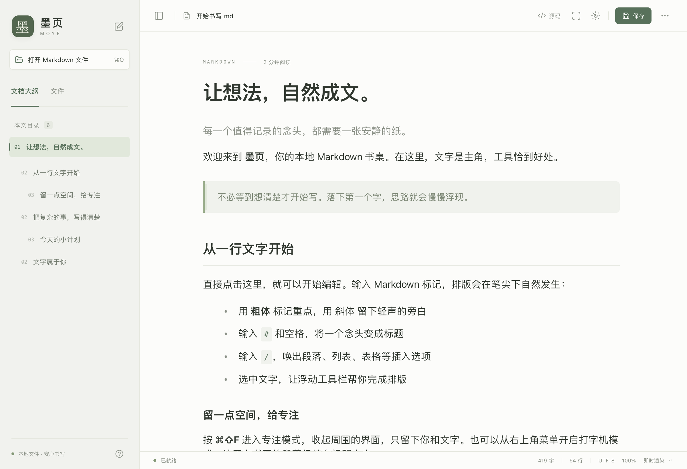
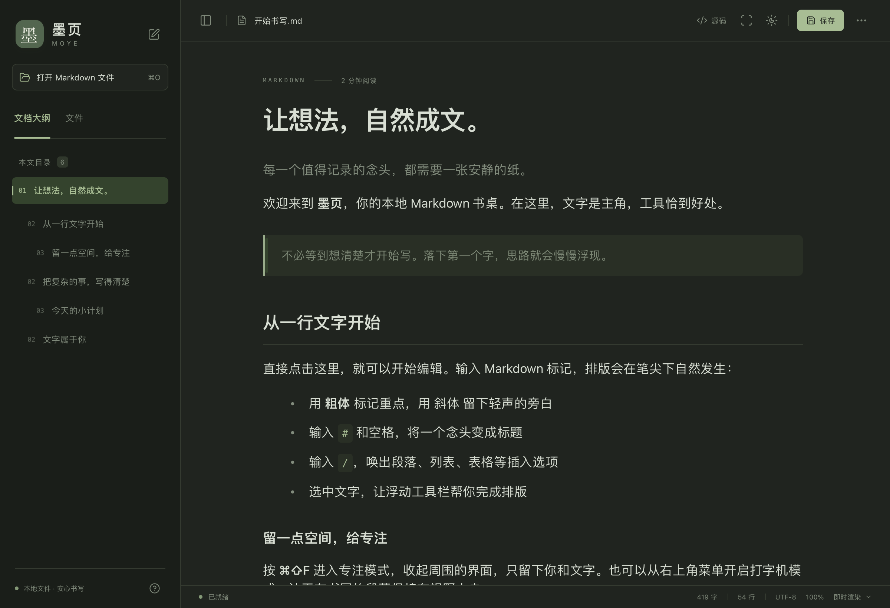

# 墨页 MoYe

一个借鉴 Typora 使用方式的 macOS Markdown 编辑器。原生 AppKit 窗口与菜单，WKWebView 内嵌 Milkdown 编辑器，运行时无需 Node.js、账户或服务器。





## 打开应用

构建产物：`build/墨页.app`。双击即可启动，也可以把它拖入“应用程序”。当前构建适用于 Apple Silicon，要求 macOS 13 或更高版本。

## 功能

- Markdown 即时渲染，标题、列表、任务清单、引用、链接、图片、表格、代码高亮与数学公式。
- 源码模式使用 CodeMirror，保留独立的撤销历史，支持语法高亮与行号。
- 文档大纲、文件夹内 Markdown 文件列表、最近打开文件。
- 原生打开、保存、另存为，UTF-8 编码，原子写入；检测磁盘上的外部修改。
- 草稿自动暂存与重启恢复；切换文档、关闭和退出时提醒保存。
- 文档查找、字数和阅读时间、明暗主题、专注模式、打字机模式、文字缩放。
- 导出 HTML、分页 PDF，以及系统打印。
- 支持从 Finder 的“打开方式”打开 `.md`、`.markdown` 和 `.mdown`。

草稿位于 `~/Library/Application Support/MoYe/draft.json`。暂存不会自动覆盖原始 Markdown 文件，请使用 ⌘S 保存。当前为单文档窗口。

本地插入的图片会以 data URL 嵌入 Markdown，保证文件复制后仍可显示；每张图片上限 10 MB。相对图片路径从文档所在文件夹解析，不读取该文件夹之外的路径。远程图片需要网络。打开文件大小上限为 20 MB。

## 快捷键

| 操作 | 快捷键 |
| --- | --- |
| 新建 / 打开 | ⌘N / ⌘O |
| 打开文件夹 | ⌘⇧O |
| 保存 / 另存为 | ⌘S / ⌘⇧S |
| 源码与即时渲染切换 | ⌘/ |
| 查找 / 下一处 | ⌘F / ⌘G |
| 粗体 / 斜体 / 链接 | ⌘B / ⌘I / ⌘K |
| 切换侧边栏 | ⌘⇧L |
| 专注模式 | ⌘⇧F |
| 字体缩放 / 还原 | ⌘+、⌘− / ⌘0 |
| 打印 | ⌘P |

输入 `/` 可打开块插入菜单，选中文字可使用浮动格式工具栏。

## 开发与构建

依赖 Node.js 22 LTS 或 24 LTS、npm 与 Xcode Command Line Tools；无需完整 Xcode。

```sh
npm install
npm run build
open "build/墨页.app"
```

`npm run dev` 只预览 Web 编辑界面；原生文件读写、文件夹与菜单功能需要运行 `.app`。

```sh
npm test
MOYE_SMOKE_RESULT="$PWD/build/smoke-result.json" "build/墨页.app/Contents/MacOS/MoYe" --smoke-test
```

集成检查在真实的 macOS WKWebView 中验证编辑器初始化、离线资源、大纲、原文保留、源码与正文编辑、模式切换、原生保存、HTML 导出及单页与多页 PDF。测试模式不读写用户草稿。

源码结构：`native/` 负责窗口、文件、草稿和系统集成；`src/` 负责编辑交互；`scripts/` 负责生成应用与图标。仅实现单文档模型，避免不必要的同步和服务层。

构建使用本地 ad-hoc 签名，尚未使用 Apple Developer ID 签名或公证；跨设备分发前需要补充正式签名。若要构建 Intel 版本，可在对应机器将脚本目标改为 `x86_64-apple-macosx13.0`。

## 开源组件

编辑引擎来自 [Milkdown](https://github.com/Milkdown/milkdown)、[ProseMirror](https://github.com/ProseMirror/prosemirror) 和 [CodeMirror](https://github.com/codemirror/dev)，图标来自 [Lucide](https://github.com/lucide-icons/lucide)，公式排版来自 [KaTeX](https://github.com/KaTeX/KaTeX)。对应许可证随应用放在 `Contents/Resources/ThirdPartyNotices.txt`。
